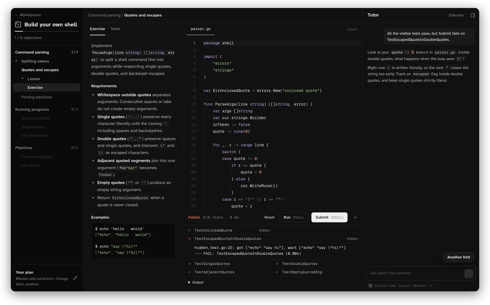
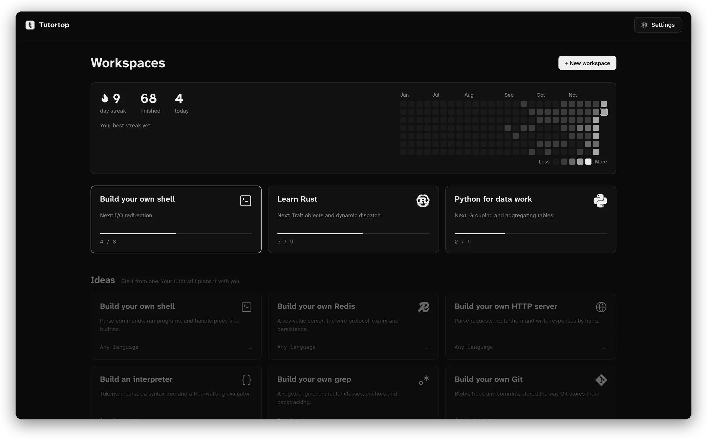

<p align="center">
  
</p>

<h1 align="center">Tutortop</h1>

<p align="center">Learn anything you can prove with code, using your own coding agent.</p>

<p align="center">
  <a href="#install"><strong>Install</strong></a> ·
  <a href="#what-you-get">What you get</a> ·
  <a href="#how-it-compares">Compare</a> ·
  <a href="#how-it-works">How it works</a> ·
  <a href="#development">Development</a>
</p>

<p align="center">
  
</p>

Tutortop gives you the structured learning loop of Boot.dev, CodeCrafters or Exercism, powered by the coding agent subscription you already pay for. You set the topic, depth and pace, read short lessons, write code in a built-in editor, and submit against a sandboxed test runner. The tests decide whether you passed. The AI never grades you.

It runs on your signed-in [Claude Code](https://docs.claude.com/en/docs/claude-code/setup), [Codex](https://github.com/openai/codex) or [Antigravity](https://antigravity.google/docs/getting-started) CLI, and works with any language you can run in Docker or Podman on macOS, Linux and Windows.

## What you get

- **Your subscriptions.** Drives the Claude Code, Codex or Antigravity CLI you already pay for. No API keys, no resold tokens.
- **Built for learning.** Lessons, exercises, test results and progress in one desktop app, instead of juggling a chat tab and a raw editor.
- **Your curriculum, your pace.** Pick any topic you can prove with code. Change the syllabus, task size or focus any time without losing passed work.
- **A tutor beside you.** Ask questions or step through four hint levels while you still write the code and do the learning.
- **No blank whiteboard.** Language server completions and optional inline Copilot suggestions keep you focused on the problem instead of fighting syntax.
- **Graded by real tests.** A local Docker or Podman sandbox runs visible and hidden tests, and checks every new exercise before you see it.
- **Open source.** [MIT licensed](LICENSE), with every workspace saved as a plain git repo on your machine.

## How it compares

| | Tutortop | Course sites | LeetCode | Agent plugins | Chat tutors |
| --- | :---: | :---: | :---: | :---: | :---: |
| **Runs on your coding agent** | ✓ | ✗ | ✗ | ✓ | ✗ |
| **Custom topic and pace** | ✓ | ✗ | ✗ | ✓ | ✓ |
| **Lessons and curriculum** | ✓ | ✓ | ✗ | ✗ | Partial |
| **Sandboxed test grading** | ✓ | ✓ | ✓ | ✗ | ✗ |
| **Dedicated study UI** | ✓ | ✓ | ✓ | ✗ | ✗ |
| **Progress from passed tests** | ✓ | ✓ | ✓ | ✗ | ✗ |

- **Course sites** (Boot.dev, CodeCrafters, Exercism): great when a fixed track matches your goal. Tutortop lets you change the syllabus as you go without another course subscription.
- **Agent plugins** (Claude Code Learning style, BodhiKit, claude-tutor, claude-code-tutor, claude-learn): live in your terminal or editor for learning inside an existing repo. Tutortop gives you a dedicated study app where the sandbox grades your code, not the agent.
- **Chat tutors** (ChatGPT Study Mode, Gemini Guided Learning, Khanmigo, Brilliant's Koji, Code.org AI Tutor): helpful for explanations and chat quizzes, without a real code editor and test runner verifying your work.

## How it works

<p align="center">
  
</p>

1. **Pick what you want to learn.** Start from a home screen idea like "Build your own shell" or type any goal of your own. Answer a few quick questions about your experience and what you want to build.
2. **Review your curriculum.** The tutor proposes modules and exercises built around your goal. Approve the plan or ask to cut, reorder or go deeper before you start.
3. **Read the lesson, then code.** Each topic starts with a short lesson, worked examples and a quick quiz for instant feedback. Skip straight to the exercise if you already know it.
4. **Write, run and submit.** Code in the built-in editor with language server completions and optional inline suggestions. Use **Run** to check visible tests as you iterate, then **Submit** to verify against hidden edge cases.
5. **Get unstuck without giving up the answer.** Ask the tutor beside your editor, or use **Hint** to step from a small nudge to a pointer or snippet before revealing anything.
6. **Steer the plan any time.** Ask for harder tasks, longer projects or a new direction. The tutor updates your curriculum while keeping everything you have already passed.

## Workspace files

Each workspace is a git repo of plain files in `~/Tutortop/<topic>`. You can pick another folder in Settings or set `TUTORTOP_HOME`.

```
MISSION.md  NOTES.md  GLOSSARY.md  RESOURCES.md  learning-records/   written by the tutor
lessons/0001-wrapping-errors/{README.md,lesson.yaml}                theory before a task
curriculum.yaml                                                      the approved plan
tasks/0001-reverse-words/{README.md,task.yaml,starter/,tests/,work/} work/ is your code
.tutortop/                                                           app state (attempts, chat)
```

Reference solutions and hidden tests live outside the workspace in `~/.local/share/tutortop/private/`, so neither you nor the tutor sees them by accident.

## Install

Tutortop needs two things it does not install for you. It shows what's missing on the home screen.

- **A sandbox:** Docker or Podman. Tutortop uses whichever is installed, Docker first. On Windows and macOS that's Docker Desktop or Podman Desktop. On Linux, Docker must work without sudo: `sudo usermod -aG docker $USER`, then log out and in. The first check for each language builds a sandbox image, which takes a few minutes.
- **A coding agent:** [Claude Code](https://docs.claude.com/en/docs/claude-code/setup) (`claude`), [Codex](https://github.com/openai/codex) (`codex`) or the [Antigravity CLI](https://antigravity.google/docs/getting-started) (`agy`), signed in. Tutortop keeps its own Antigravity profile so it doesn't change your agy settings; if agy asks you to sign in there, Tutortop shows the command to run.

Git is optional. With it, every workspace keeps a history of its changes.

On macOS or Linux, run this in a terminal:

```sh
curl -fsSL https://raw.githubusercontent.com/LukasKH/tutortop/main/install.sh | sh
```

On Windows, run this in PowerShell:

```powershell
irm https://raw.githubusercontent.com/LukasKH/tutortop/main/install.ps1 | iex
```

The scripts ([install.sh](install.sh) and [install.ps1](install.ps1)) download the newest release and install it. On Linux they use apt, dnf or pacman, which ask for your password, or put the AppImage in `~/.local/bin` if you have none of those. Installed this way, macOS opens the app without blocking it. Windows still asks to let an unknown publisher make changes.

Or download the installer for your system from [Releases](https://github.com/LukasKH/tutortop/releases):

| System | File | Install |
| --- | --- | --- |
| Ubuntu 24.04+, Debian 13+ | `.deb` | `sudo apt install ./tutortop_amd64.deb` |
| Fedora | `.rpm` | `sudo dnf install ./tutortop-x86_64.rpm` |
| Arch | `.pkg.tar.zst` | `sudo pacman -U tutortop-x86_64.pkg.tar.zst` |
| Other Linux | `.AppImage` | `chmod +x` it and run it |
| Windows 10/11 | `-setup.exe` | Run it. It's unsigned, so SmartScreen asks first: *More info → Run anyway*. |
| macOS | `.dmg` | Drag to Applications. It's unsigned, so the first time macOS blocks it: open *System Settings → Privacy & Security* and click *Open Anyway*. |

## Development

### Requirements

- Go 1.27+, Node 26+ and the Wails v3 CLI (`wails3`). Run `mise install` to get the pinned versions. The code uses Go 1.27 features, so older Go won't build it: generic methods (`rpcConn.Call[T]`, `process.await[T]` in `internal/agent`) and the standard library's `uuid` package. On Linux, installing `wails3` and running `wails3 dev` also need a C compiler, `pkg-config`, GTK4 and WebKitGTK 6.0 dev headers (`libgtk-4-dev` and `libwebkitgtk-6.0-dev` on Ubuntu and Debian).
- Docker or Podman, and at least one of Claude Code, Codex or Antigravity, as above.

### Commands

```sh
mise install                      # Go, Node, golangci-lint, pre-commit and wails3, pinned in mise.toml
pre-commit install                # git hooks: lint + tests before commit, Conventional Commits on the message
wails3 dev                        # run the app with hot reload
wails3 task test                  # Go tests with the race detector (needs Docker or Podman)
wails3 task lint                  # go vet, Staticcheck and format checks
wails3 task format                # format Go code and imports
npm --prefix frontend run format  # format the frontend (Prettier, sorts Tailwind classes)
npm --prefix frontend run lint    # lint the frontend (Oxlint, React hooks rules)
npm --prefix frontend test        # frontend tests (Vitest)
wails3 task test:live             # talks to the real Claude Code, Codex and Antigravity CLIs; uses a little quota
```

[docs/architecture.md](docs/architecture.md) explains how the Go backend, the frontend and Wails fit together, and [docs/GLOSSARY.md](docs/GLOSSARY.md) defines the words used in the code.

### Contributing

Code follows [STYLEGUIDE.md](STYLEGUIDE.md). The pre-commit hooks and GitHub Actions run:

- golangci-lint: go vet's analyzers, Staticcheck, exhaustive (switches over enum-like types cover every case), gocognit and nestif (functions stay shallow), and gofmt/goimports formatting (`.golangci.yml`).
- `go test -race -short ./internal/...`.
- A TypeScript typecheck, an Oxlint lint, a Prettier format check and the Vitest tests of the frontend, when frontend files change.

Commit messages follow [Conventional Commits](https://www.conventionalcommits.org/) (`feat:`, `fix:`, `refactor:`, `docs:`, `test:`, `build:`, `ci:`, `chore:`), checked by commitlint.

## License

MIT. See [LICENSE](LICENSE).
